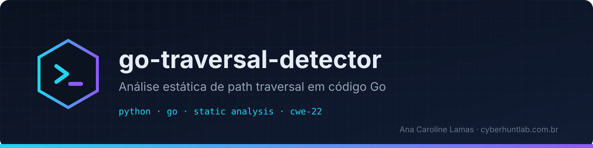

<p align="center"></p>

# go-traversal-detector — análise estática de path traversal (CWE-22) em Go

Ferramenta de **análise estática** em **Python** que encontra usos de `filepath.Join`, `os.Open` e funções semelhantes que recebem **caminho de origem não confiável** em código **Go**, e verifica se a **mesma função** tem uma **barreira de contenção** antes de apontar o candidato. Reconhece `strings.HasPrefix`, `filepath.Rel`, `os.Root`, `SecureJoin` e helpers internos como `doSafeMakeDir`.

> A ferramenta **não executa código, não prova exploração e não gera PoC**. Ela aponta **candidatos à revisão manual**; um achado é um lugar para ler o código, nunca uma vulnerabilidade confirmada.

## Recursos

- **Busca de *sinks*** de sistema de arquivos com entrada suspeita.
- **Verificação de contenção** na própria função, inclusive quando a checagem é delegada a um helper conhecido.
- **Classificação**:
  - **revisar**: o *sink* recebe entrada suspeita e não há barreira visível na função;
  - **provavelmente-seguro**: existe uma barreira; ainda vale conferir se ela cobre aquele caminho.
- **Autoteste** embutido (`--test`).
- Sem dependências externas.

## Instalação

Requisitos: **Python 3.10+**.

```bash
git clone https://github.com/ticarollamas-arch/go-traversal-detector.git
cd go-traversal-detector
```

## Como usar

```bash
python3 gotraversal.py ./projeto-go     # analisa um diretório
python3 gotraversal.py arquivo.go       # analisa um arquivo
python3 gotraversal.py --test           # roda o autoteste
```

## Por que verificar a contenção

Path traversal em Go costuma depender de uma pergunta: o caminho montado com `filepath.Join` fica contido no diretório base? A checagem muitas vezes está logo ao lado ou numa função auxiliar. Um scanner que só procura `filepath.Join` gera falso positivo em quase todo projeto.

**Exemplo real**: no `SafeMakeDir` do Kubernetes (`pkg/volume/util/subpath/subpath_linux.go`), o detector classifica a função como **provavelmente-seguro**, porque ela delega a `doSafeMakeDir`, que contém a checagem. Uma ferramenta ingênua marcaria "vulnerável", e o report seria fechado como não aplicável.

## Limitações

- A análise é por função, dentro de um arquivo: não segue barreiras em outros arquivos ou pacotes.
- Reconhece um conjunto conhecido de barreiras; sanitizações incomuns podem gerar "revisar" indevido.
- É ponto de partida para leitura humana, não veredito.

## Tecnologias

Python 3 · análise estática · Go · CWE-22 (Path Traversal)

## Licença

Distribuído sob a licença MIT. Veja [LICENSE](LICENSE).
